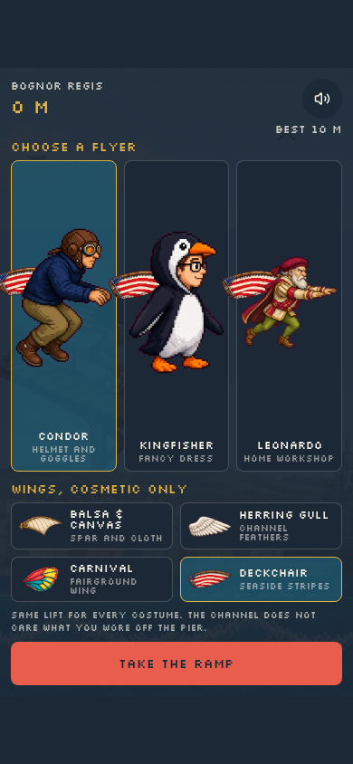
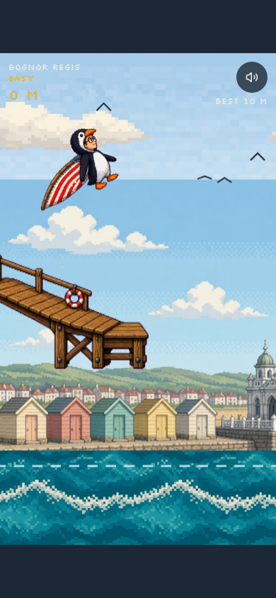

# Birdman

A tap-to-flap flight off Bognor Regis Pier, in the spirit of the old International Birdman contest. You pick a homemade flyer, strap on costume wings, and try to stay above the Channel.

Play it at [birdman.grok.me](https://birdman.grok.me).

The wings are cosmetic. Every costume has the same glide.

<p>
  
  
</p>

## Play

1. Wait for the pier to load.
2. Choose a difficulty, a flyer, and a set of wings.
3. Take the ramp.
4. Tap, click, or press space to climb. Gravity does the rest.

| Difficulty | What changes |
| --- | --- |
| Easy | Slower. Hazards come from the sky or the sea, not both. |
| Normal | Quicker, with a mix of single posts and gates. |
| Hard | Fast and tight. Every obstacle is a gate. |

Your best distance is stored in this browser.

## Controls

| Action | Input |
| --- | --- |
| Climb | Tap, click, or space |
| Pause | Pause button, or Esc / P |
| Leave a flight | Esc again while paused |
| Mute | Mute button, in flight only |

## Develop

```bash
npm install
npm run dev
```

The dev server listens on port 8080.

```bash
npm test
npm run typecheck
npm run build
```

`npm test` covers the flight rules in `src/game/run.test.ts`: flap and pause, sea and pier collisions, the 46 m, 100 m, and 206 m marks, easy versus hard hazards, and the score lines. It also runs the project script tests.

## Layout

- `src/components/birdman-app.tsx` — hangar, HUD, and the game loop
- `src/game/run.ts` — flap physics, courses, and obstacles
- `src/game/draw.ts` — canvas drawing
- `src/assets/sprites/` — flyers, wings, and the pier

## Licence

[MIT](LICENSE)
